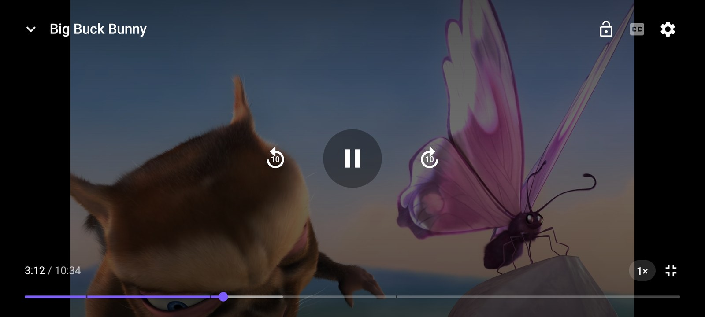
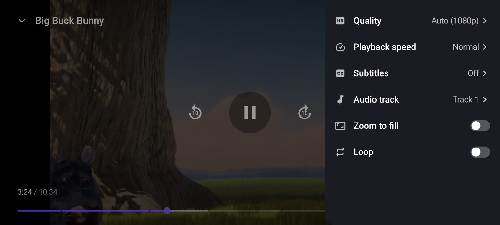
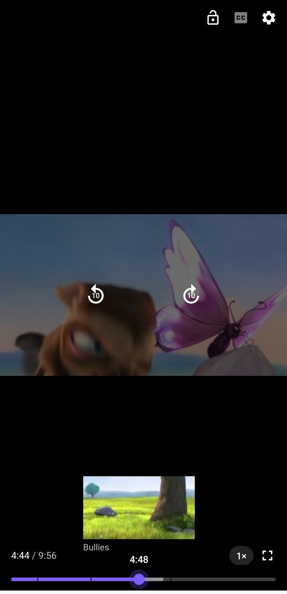
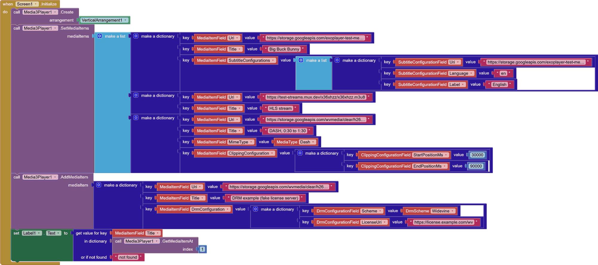

# ExoPlayer for App Inventor (v3)

A video and audio player extension for MIT App Inventor and App Inventor based
platforms, built on [AndroidX Media3](https://developer.android.com/media/media3).

The successor of [exoplayer-appinventor](https://github.com/zainulhassan815/exoplayer-appinventor),
built with [Rush](https://github.com/zainulhassan815/rush-cli), which ships Media3 as
real AARs with their resources.

<p>
  
  
</p>
<p>
  
  
</p>

## Getting started

1. Download `dev.dreamerslab.media3.aix` from the
   [latest release](https://github.com/zainulhassan815/exoplayer-appinventor-v3/releases/latest)
   and import it in App Inventor (Palette → Extension → Import extension).
2. Add an arrangement, for example a VerticalArrangement with Width *Fill parent* and a
   fixed Height, and a **Media3Player** component.
3. In `Screen1.Initialize`, call `Media3Player1.Create(VerticalArrangement1)`.
4. Call `Play(source, title)`, and `AddToQueue(source, title)` for more media. Sources
   are URLs or names of media assets uploaded to the project. For subtitles, DRM and other
   settings, use [media items](#media-items).
5. Build an APK to try it. The AI Companion can't load the Media3 libraries the
   extension ships, so the player doesn't work in it.

Each release also has `Media3Sample.aia`, a ready-made project to import (My Projects →
Import project), and `dev.dreamerslab.media3.md`, the documentation of every block.

Requirements: Android 6.0 or newer (`CaptureFrame` needs Android 7.0). The extension
adds about 12 MB to apps.

## Features

- Modern player UI: auto-hiding controls, seek bar with buffering and chapters,
  previous / next, ±10s, speed chip, subtitles and settings
- Gestures: double tap to seek, hold for 2× speed, pinch to zoom, swipe for brightness
  and volume in fullscreen, each of which can be turned off
- D-pad and remote navigation: every control and the seek bar take focus, and the first
  key shows hidden controls
- Fullscreen with landscape or portrait orientation, matching the video
- Settings sheet: quality, playback speed, subtitles, audio track, zoom and loop
- Downloads for offline playback, a disk cache for streams and preloading of the next media
- Equalizer, bass boost, loudness boost, mono and left/right balance
- Background playback with a media notification, lock screen and headset controls
- Queue with an up next countdown, replay, error and retry states, and a controls lock
- Media items as dictionaries: build playlists with blocks or load them from JSON
- MP4, HLS, DASH, SmoothStreaming and RTSP, live streams with a LIVE indicator, DRM
  (Widevine, ClearKey, PlayReady), custom HTTP headers; side-loaded WebVTT, SRT, TTML
  and SSA subtitles
- Accent color, resize mode, fullscreen orientation, repeat mode and behavior
  configurable from the designer

## Media items

A media item is a dictionary that describes one media and how to play it. Build it with
App Inventor's `make a dictionary` block and take each key from a dropdown, so field names
can't be misspelled; only the uri is required. Pass items to `SetMediaItems`,
`AddMediaItems`, `AddMediaItem` or `ReplaceMediaItem`, and read them back with
`GetMediaItemAt`.



The keys come from five dropdowns, one for each part of a media item, named after
Media3's `MediaItem` classes:

| Dropdown | Fields |
|---|---|
| `MediaItemField` | `Uri`, `Title`, `Artist`, `Description`, `ArtworkUri`, `MimeType` (a `MediaType`), `DrmConfiguration`, `SubtitleConfigurations` (a list), `ClippingConfiguration`, `Thumbnails` |
| `DrmConfigurationField` | `Scheme` (a `DrmScheme`, Widevine when missing), `LicenseUri`, `LicenseRequestHeaders`, `ClearKeys` (key ID → key, in hex, instead of a license server) |
| `SubtitleConfigurationField` | `Uri`, `Language`, `Label` |
| `ClippingConfigurationField` | `StartPositionMs`, `EndPositionMs` (0 plays to the end) |
| `ThumbnailsField` | `Uri` of a WebVTT thumbnail track (like `storyboard.vtt`), or of a sprite sheet with `Columns`, `Rows` and `IntervalMs` |

Playlists decoded from JSON work as they are, with the field names as text keys:

```json
{ "uri": "https://example.com/movie.mpd", "title": "Movie", "mimeType": "DASH",
  "drmConfiguration": { "scheme": "Widevine", "licenseUri": "https://example.com/license" },
  "subtitleConfigurations": [ { "uri": "https://example.com/en.vtt", "language": "en" } ] }
```

`SetMediaItemField`, `SetDrmConfigurationField`, `SetSubtitleConfigurationField`,
`SetClippingConfigurationField` and `SetThumbnailsField` change one field of a media item
already in the queue. Every item is checked when it's passed to the player: an unknown or
misplaced key, a missing uri or a value of the wrong type raises `Screen.ErrorOccurred`
with error 30106 and a message naming the field, like `mediaItems[3].mimeType: "HSL" isn't
one of Auto, HLS, DASH, SmoothStreaming, RTSP, Progressive.`

## Blocks

| Functions | |
|---|---|
| `Create(arrangement)` | Shows the player inside the arrangement |
| `Play(source, title)` / `PlayFrom(source, title, positionMs)` | Plays media, replacing the queue |
| `AddToQueue(source, title)` / `InsertAt(index, source, title)` | Adds media to the queue |
| `RemoveAt(index)` / `MoveItem(from, to)` | Edits the queue |
| `SetMediaItems(mediaItems)` | Plays a list of [media items](#media-items), replacing the queue |
| `AddMediaItem(mediaItem)` / `AddMediaItems(mediaItems)` | Adds media items to the end of the queue |
| `ReplaceMediaItem(index, mediaItem)` / `GetMediaItemAt(index)` | Replaces or reads a media item in the queue |
| `SetMediaItemField(index, field, value)` and one block per part of a media item | Changes one field of a queued media item |
| `SetHeader(name, value)` / `ClearHeaders()` | HTTP headers sent with every media request |
| `SeekToLiveEdge()` | Jumps to the live edge of a live stream |
| `Download(source, title)` / `RemoveDownload(source)` / `RemoveAllDownloads()` | Downloads media for offline playback |
| `IsDownloaded(source)` / `DownloadProgress(source)` | Download status |
| `ClearCache()` | Deletes cached media |
| `IncreaseDeviceVolume()` / `DecreaseDeviceVolume()` | Changes the phone's media volume by one step |
| `UseEqualizerPreset(name)` / `SetBandLevel(band, decibels)` / `BandLevel(band)` | Equalizer |
| `SelectQuality(index)` / `SelectAudioTrack(index)` / `SelectSubtitle(index)` | Chooses from `VideoQualities`, `AudioTracks` and `SubtitleTracks` |
| `AddChapter(startSeconds, title)` / `ClearChapters()` | Chapters shown while scrubbing |
| `Resume()` / `Pause()` / `Stop()` / `Replay()` / `SeekTo(positionMs)` | Playback control |
| `Next()` / `Previous()` / `PlayAt(index)` / `SeekToItem(index, positionMs)` / `ClearQueue()` | Queue control |
| `EnterFullscreen()` / `ExitFullscreen()` | Fullscreen control |
| `ShowAsDialog()` / `CloseDialog()` | Shows the player in a dialog over the screen |
| `MoveTo(arrangement)` | Moves the player into another arrangement |
| `CaptureFrame(fileName)` | Saves the current video frame as a PNG image |

Events: `PlaybackStateChanged`, `IsPlayingChanged`, `BufferingChanged`, `PositionChanged`,
`MediaChanged`, `MetadataChanged`, `StreamTitleChanged`, `QueueChanged`, `TracksChanged`,
`VideoSizeChanged`, `FirstFrameRendered`, `SpeedChanged`, `RepeatModeChanged`, `ShuffleModeEnabledChanged`, `FullscreenChanged`, `DialogClosed`, `DownloadChanged`, `FrameCaptured`, `SubtitleChanged`,
`DeviceVolumeChanged`,
`PlayerError(message, errorCode, category)` with category Network, NotFound, Format, Decoder,
DRM or Other.

Mistakes in blocks raise `Screen.ErrorOccurred` with these error numbers:

| Error | Raised when |
|---|---|
| 30101 | An index is outside the queue |
| 30102 | An index is outside a track list or the equalizer bands, or no equalizer preset has the name |
| 30103 | `CaptureFrame` can't capture or save a frame |
| 30104 | The deprecated `SetThumbnails` gets fewer than 1 column or row, or no interval |
| 30105 | The deprecated `SetClearKeys` gets a malformed key |
| 30106 | A media item is invalid |

Deprecated blocks, kept working for existing projects but hidden from the blocks drawer:
`AddSubtitle`, `ClipMedia`, `SetDrm`, `SetClearKeys`, `SetMediaType`, `SetMetadata`,
`SetThumbnails` and `SetThumbnailTrack`. They change the most recently added media; use
media items instead.

Properties, grouped in the designer:

- Appearance: `ShowControls`, `ShowPreviousNext`, `ShowSeekButtons`, `ShowSpeedButton`,
  `ShowSubtitlesButton`, `ShowSettingsButton`, `ShowFullscreenButton`, `ShowLockButton`,
  `ShowTitle`, `ShowTimeBar`, `BackgroundColor`, `ControlsColor`, `ScrimColor`,
  `SeekBarTrackColor`, `SeekBarBufferedColor`, `CornerRadius`, `PosterImage`,
  `ShowRemainingTime`, `AccentColor`, `ResizeMode` (Fit, Fill, Zoom, Fixed width, Fixed height),
  `FullscreenOrientation` (Auto, Landscape, Portrait, Sensor), `SubtitleSize`,
  `SubtitleTextColor`, `SubtitleBackgroundColor`, `SubtitleEdge`, `SubtitleBottomMargin`
- Behavior: `SeekIncrement`, `ControlsTimeout`, `DoubleTapToSeek`, `HoldForSpeed`,
  `SwipeForBrightness`, `SwipeForVolume`, `PinchToZoom`, `KeepScreenOn`, `BackgroundPlayback`, `AudioFocus`,
  `PositionUpdateInterval`, `PreloadNext`, `EqualizerEnabled`, `BassBoost`, `LoudnessBoost`, `Mono`,
  `Balance`, `RepeatMode`
  (Off, One, All), `Shuffle`, `Autoplay`, `Volume`, `Muted`, `Pitch`, `SkipSilence`,
  `SeekMode` (Exact, Closest keyframe), `PlaybackSpeed`, `AutoAdvance`, `UpNextCountdown`, `PreferredAudioLanguage`,
  `PreferredSubtitleLanguage`, `ShowSubtitles`, `MaxVideoHeight`, `MaxVideoBitrate`
- Advanced: `UserAgent`, `TargetLiveOffset`, `CacheSize`
- Read-only: `IsPlaying`, `PlaybackState`, `IsFullscreen`, `IsLive`, `LiveOffset`, `Position`, `Duration`,
  `Title`, `Artist`, `Queue`, `QueueLength`, `CurrentIndex`, `HasNext`, `HasPrevious`,
  `VideoQualities`, `AudioTracks`, `SubtitleTracks`, `IsDialogShowing`, `BufferedPosition`,
  `BufferedPercentage`, `VideoWidth`, `VideoHeight`, `VideoBitrate`, `DroppedFrames`,
  `BandwidthEstimate`, `EqualizerPresets`, `EqualizerPreset`, `EqualizerBands`,
  `EqualizerMinLevel`, `EqualizerMaxLevel`, `CacheUsed`, `Downloads`, `DeviceMinVolume`,
  `DeviceMaxVolume`
- Phone volume: `DeviceVolume`, `DeviceMuted`

## Several players

Players pause when other audio starts, including another player in the app, as Android
media players should, so starting one pauses the others. Turn `AudioFocus` off on players
that should play on their own. Muted players never pause others or get paused.

## Publishing on Google Play

For `BackgroundPlayback` and `Download`, the extension declares two foreground services
in every app that uses it: media playback and data sync, with their permissions. Google
Play asks apps to explain each foreground service type they declare in the Play Console
(App content → Foreground service permissions). Describe them as playing media in the
background and downloading media for offline playback.

## FAQ

**Does it work in the AI Companion?** No. The Companion can't load the Media3 libraries the
extension ships. Build an APK to test.

**Can it play YouTube or Google Drive links?** No. A YouTube page isn't a media URL, and
playing YouTube outside its official players is against YouTube's terms. A Drive share link
opens a web page; use a direct download link to the file instead.

**Can it cast to a TV, show ads, or play in picture-in-picture?** No. Casting and IMA ads
need Google Play Services libraries and setup App Inventor doesn't provide, and
picture-in-picture needs a setting on the screen's activity that extensions can't change.

**Why can't I seek in some MKV files?** The file has no seek index (cues). That's a
property of the file; remuxing it, for example with `ffmpeg -i in.mkv -c copy out.mkv`,
adds one.

**Why doesn't a video play while others do?** Codecs like HEVC 10-bit, AC-3/E-AC-3 and DTS
depend on the phone's decoders. Check `PlayerError`: category Decoder or Format means the
device can't decode that file.

**Does it play live streams and internet radio?** Yes: HLS, DASH and RTSP live streams, and
radio streams with their titles in `StreamTitleChanged`.

## Building

Requires [Rush 2.5](https://github.com/zainulhassan815/rush-cli) or newer and JDK 17.

```sh
rush build
python3 samples/package.py
```

The extension and its block documentation are generated in the `out` directory, and the
second command packs the sample project with it. `design/player-mockup.html` is the
interactive mockup the player UI is built from.

GitHub Actions builds every push. To release, update `version` in `rush.yml`, commit, and
push a tag with the same version, like `v3.0.0`: the release is published with the
extension, its documentation and the sample project.

## License

[MPL-2.0](LICENSE). Use the extension in any app, free or commercial, and keep your
app's code to yourself. If you change the extension's own files and distribute them,
share those changes under the same license.
