# Blocks

Every block of Media3Player 3.2.0. Each image contains its block, so you can drag it straight into your workspace.

- [Functions: Setup and playback](#functions-setup-and-playback)
- [Functions: Queue](#functions-queue)
- [Functions: Media items](#functions-media-items)
- [Functions: Fullscreen, dialog and frames](#functions-fullscreen-dialog-and-frames)
- [Functions: Tracks, chapters and requests](#functions-tracks-chapters-and-requests)
- [Functions: Audio and volume](#functions-audio-and-volume)
- [Functions: Downloads and cache](#functions-downloads-and-cache)
- [Events](#events)
- [Properties: Appearance](#properties-appearance)
- [Properties: Behavior](#properties-behavior)
- [Properties: Advanced](#properties-advanced)
- [Properties: Phone volume](#properties-phone-volume)
- [Properties: Read-only](#properties-read-only)
- [Dropdowns](#dropdowns)

## Functions: Setup and playback

Shows the player and controls playback.

**Create:** Shows the player inside the given arrangement.

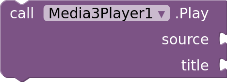

**Play:** Plays the media at the given url or asset name, replacing the queue.

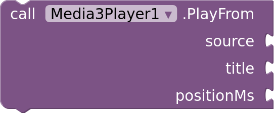

**PlayFrom:** Plays the media at the given url or asset name from the given position in milliseconds, replacing the queue.

**Resume:** Resumes playback.

**Pause:** Pauses playback, keeping the position and the buffered media. Resume plays on.

**Stop:** Stops playback and releases the media, keeping the queue. Resume plays it again.

**Replay:** Plays the current media again from the start.

**SeekTo:** Seeks to the given position in milliseconds in the current media.

**SeekToLiveEdge:** Jumps to the live edge of a live stream.

## Functions: Queue

Builds and moves through the queue. Indexes start at 1.

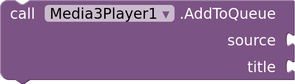

**AddToQueue:** Adds the media at the given url or asset name to the end of the queue.

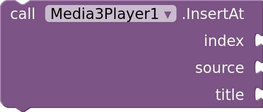

**InsertAt:** Inserts the media at the given url or asset name at the given position in the queue. Index starts at 1; one more than the queue length adds it to the end.

**RemoveAt:** Removes the media at the given position from the queue. Index starts at 1.

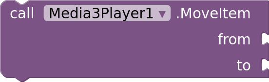

**MoveItem:** Moves the media at one position in the queue to another. Indexes start at 1.

**PlayAt:** Plays the media at the given position in the queue. Index starts at 1.

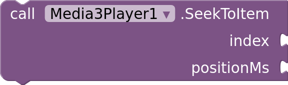

**SeekToItem:** Plays the media at the given position in the queue from the given position in milliseconds. Index starts at 1.

**Next:** Plays the next media in the queue.

**Previous:** Plays the previous media in the queue, or restarts the current one.

**ClearQueue:** Removes all media from the queue and stops playback.

## Functions: Media items

Media items describe one media and how to play it, as a dictionary with keys from the field dropdowns. See [Media items](../README.md#media-items).

**SetMediaItems:** Plays the given media items, replacing the queue. Each media item is a dictionary whose keys are MediaItemField choices; only Uri is required.

**AddMediaItem:** Adds a media item to the end of the queue. The media item is a dictionary whose keys are MediaItemField choices; only Uri is required.

**AddMediaItems:** Adds a list of media items to the end of the queue, like AddMediaItem for each.

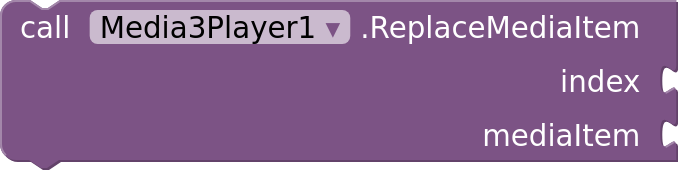

**ReplaceMediaItem:** Replaces the media item at the given position in the queue with another, which plays from the start if it was the current media. Index starts at 1.

**GetMediaItemAt:** The media item at the given position in the queue, as a dictionary. Index starts at 1.

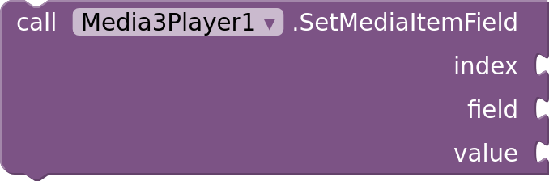

**SetMediaItemField:** Changes one field of the media item at the given position in the queue. Index starts at 1.

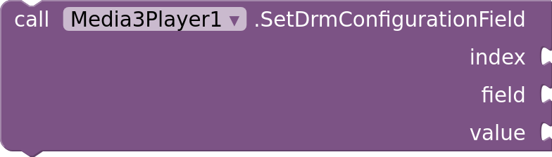

**SetDrmConfigurationField:** Changes one DRM setting of the media item at the given position in the queue. Index starts at 1.

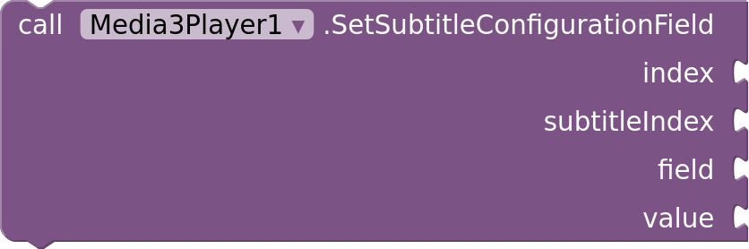

**SetSubtitleConfigurationField:** Changes one setting of a subtitle of the media item at the given position in the queue. Both indexes start at 1.

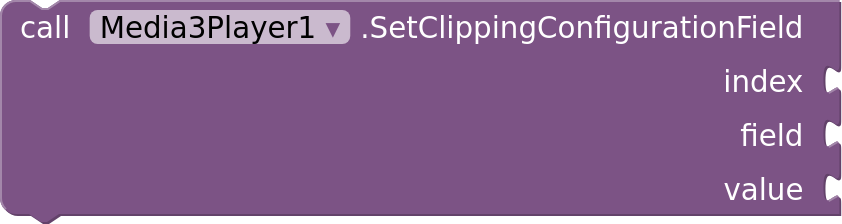

**SetClippingConfigurationField:** Changes where the media item at the given position in the queue starts or ends. Index starts at 1.

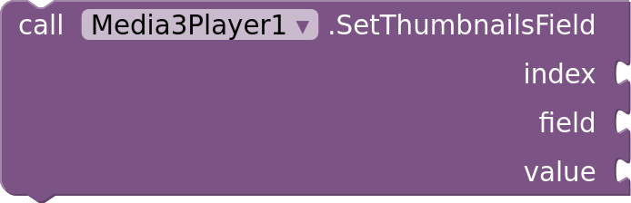

**SetThumbnailsField:** Changes one thumbnails setting of the media item at the given position in the queue. Index starts at 1.

## Functions: Fullscreen, dialog and frames

Where the player is shown, and saving frames.

**EnterFullscreen:** Shows the player fullscreen.

**ExitFullscreen:** Leaves fullscreen.

**ShowAsDialog:** Shows the player in a dialog over the screen. Tapping outside or pressing back closes it.

**CloseDialog:** Closes the dialog shown by ShowAsDialog and returns the player to its arrangement.

**MoveTo:** Moves the player into another arrangement, keeping what it plays.

**CaptureFrame:** Saves the current video frame as a PNG image and fires FrameCaptured with its path. A file name without a folder is saved in the app's files folder. Protected (DRM) video can't be captured.

## Functions: Tracks, chapters and requests

Quality, audio and subtitle tracks, chapters, and HTTP headers.

**SelectQuality:** Plays the video quality at the given position in VideoQualities. Index starts at 1; 1 is Auto.

**SelectAudioTrack:** Plays the audio track at the given position in AudioTracks. Index starts at 1.

**SelectSubtitle:** Shows the subtitles at the given position in SubtitleTracks. Index starts at 1; 1 turns subtitles off.

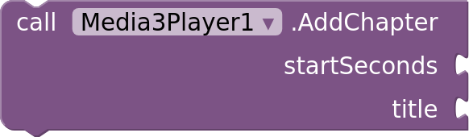

**AddChapter:** Adds a chapter starting at the given second, shown on the seek bar while scrubbing.

**ClearChapters:** Removes all chapters.

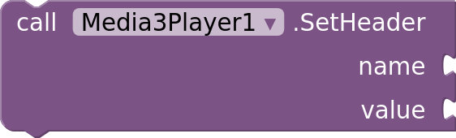

**SetHeader:** Sends the given HTTP header with every media request.

**ClearHeaders:** Stops sending the headers set with SetHeader.

## Functions: Audio and volume

The equalizer and the phone's media volume.

**UseEqualizerPreset:** Uses the equalizer preset with the given name from EqualizerPresets.

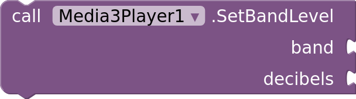

**SetBandLevel:** Sets the level of an equalizer band in decibels, between EqualizerMinLevel and EqualizerMaxLevel. Band starts at 1, in the order of EqualizerBands.

**BandLevel:** Level of an equalizer band in decibels. Band starts at 1.

**IncreaseDeviceVolume:** Turns the phone's media volume up by one step.

**DecreaseDeviceVolume:** Turns the phone's media volume down by one step.

## Functions: Downloads and cache

Offline playback and the stream cache.

**Download:** Downloads the media at the given url for offline playback. Playing the same url plays the download, even without a connection.

**RemoveDownload:** Deletes the download of the media at the given url.

**RemoveAllDownloads:** Deletes all downloads.

**IsDownloaded:** Whether the media at the given url is fully downloaded.

**DownloadProgress:** How much of the media at the given url has downloaded, from 0 to 100.

**ClearCache:** Deletes the media stored by the cache.

## Events

Events fire on the main thread, after Screen.Initialize.

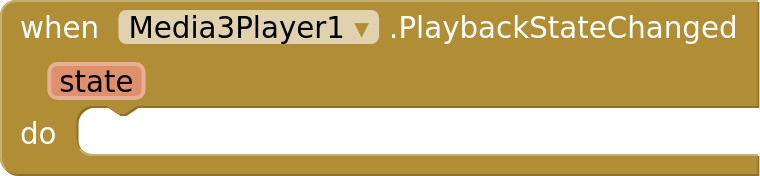

**PlaybackStateChanged:** The playback state changed to IDLE, BUFFERING, READY or ENDED.

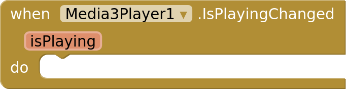

**IsPlayingChanged:** Playback started or stopped.

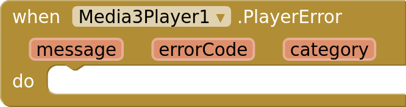

**PlayerError:** Playback failed.

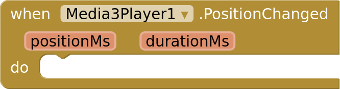

**PositionChanged:** Sent every PositionUpdateInterval milliseconds while media plays.

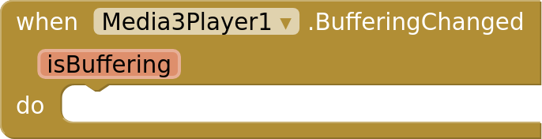

**BufferingChanged:** The player started or stopped waiting for media to load.

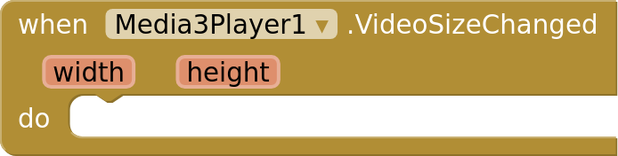

**VideoSizeChanged:** The size of the video changed, for example when another quality started playing.

**FirstFrameRendered:** The first frame of the video appeared.

**SpeedChanged:** The playback speed changed.

**RepeatModeChanged:** The repeat mode changed, from blocks or from the loop setting in the player.

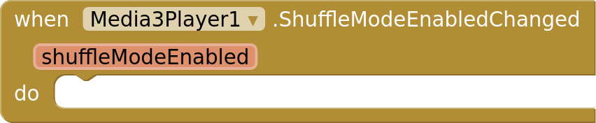

**ShuffleModeEnabledChanged:** Shuffle was turned on or off.

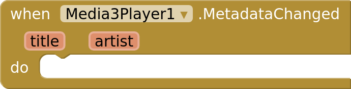

**MetadataChanged:** The title or artist of the current media changed.

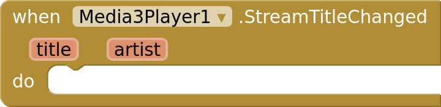

**StreamTitleChanged:** A stream announced what is playing now, like the song on an internet radio station. Either may be empty; radio stations often send "Artist - Song" as the title.

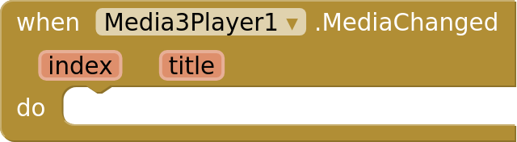

**MediaChanged:** Another media in the queue started. Index starts at 1.

**TracksChanged:** The video qualities, audio tracks or subtitles of the current media changed, for example once it loaded.

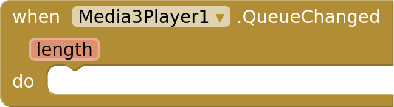

**QueueChanged:** Media was added to, removed from, moved in or replaced in the queue.

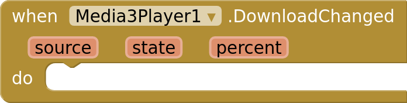

**DownloadChanged:** A download changed state: Queued, Downloading, Completed, Failed, Stopped, Removing, Restarting or Removed.

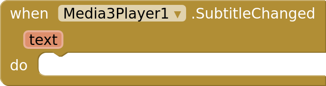

**SubtitleChanged:** The subtitle on screen changed. Text holds its lines, or is empty when no subtitle shows. Useful to show subtitles your own way, for example with ShowControls off.

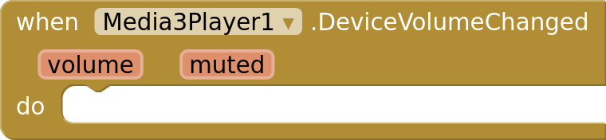

**DeviceVolumeChanged:** The phone's media volume changed, from this app or outside it.

**FrameCaptured:** CaptureFrame saved a video frame to the given path.

**DialogClosed:** The dialog shown by ShowAsDialog was closed.

**FullscreenChanged:** The player entered or left fullscreen.

## Properties: Appearance

Also in the designer, under Appearance.

 

**ShowControls** (read-write): Shows the built-in controls, gestures and overlays. Turn off to build your own controls with blocks.

 

**ShowPreviousNext** (read-write): Shows the previous and next buttons when the queue has more than one media.

 

**ShowSeekButtons** (read-write): Shows the rewind and forward buttons.

 

**ShowSpeedButton** (read-write): Shows the playback speed button.

 

**ShowSubtitlesButton** (read-write): Shows the subtitles button.

 

**ShowSettingsButton** (read-write): Shows the settings button.

 

**ShowFullscreenButton** (read-write): Shows the fullscreen button.

 

**ShowLockButton** (read-write): Shows the button that locks the controls.

 

**ShowTitle** (read-write): Shows the title of the media in fullscreen.

 

**ShowTimeBar** (read-write): Shows the seek bar.

 

**BackgroundColor** (read-write): Color shown around and behind the video.

 

**ControlsColor** (read-write): Color of the control icons and text.

 

**ScrimColor** (read-write): Color of the shading behind the controls.

 

**SeekBarTrackColor** (read-write): Color of the unplayed part of the seek bar.

 

**SeekBarBufferedColor** (read-write): Color of the buffered part of the seek bar.

 

**CornerRadius** (read-write): Roundness of the player's corners, in pixels.

 

**PosterImage** (read-write): Image shown before the video starts, and for audio without its own artwork. A URL or asset name.

 

**ShowRemainingTime** (read-write): Shows the time left instead of the duration next to the position.

 

**AccentColor** (read-write): Color of the seek bar, buttons and highlights.

 

**ResizeMode** (read-write): How the video fits the player.

 

**FullscreenOrientation** (read-write): Orientation of the screen in fullscreen.

 

**SubtitleSize** (read-write): Size of subtitles in percent of the default size.

 

**SubtitleTextColor** (read-write): Color of the subtitle text.

 

**SubtitleBackgroundColor** (read-write): Color behind the subtitle text.

 

**SubtitleEdge** (read-write): Edge drawn around the subtitle text, in black.

 

**SubtitleBottomMargin** (read-write): Space below the subtitles, in percent of the player's height.

## Properties: Behavior

Also in the designer, under Behavior.

 

**BackgroundPlayback** (read-write): Keeps playing when the app goes to the background, with a media notification and controls on the lock screen and for headsets.

 

**KeepScreenOn** (read-write): Keeps the screen on while media plays.

 

**SeekIncrement** (read-write): Seconds skipped by the rewind and forward buttons and double taps, at least 1.

 

**ControlsTimeout** (read-write): Milliseconds of inactivity after which the controls hide.

 

**DoubleTapToSeek** (read-write): Double tap the sides to rewind or forward, and the middle to play or pause.

 

**HoldForSpeed** (read-write): Touch and hold to play at 2× speed.

 

**SwipeForBrightness** (read-write): Swipe up or down on the left in fullscreen to change the brightness.

 

**SwipeForVolume** (read-write): Swipe up or down on the right in fullscreen to change the volume.

 

**PinchToZoom** (read-write): Pinch out to zoom the video to fill the player, and in to fit it.

 

**RepeatMode** (read-write): Whether the current media or the whole queue repeats.

 

**Shuffle** (read-write): Shuffles the order the queue plays in.

 

**Autoplay** (read-write): Starts playing as soon as Play, PlayFrom or SetMediaItems loads media.

 

**Volume** (read-write): Volume of the player, from 0 to 100.

 

**AudioFocus** (read-write): Pauses this player when other audio starts, like a call, another app or another player in this app, as media players should. Turn off to play independently, for example several players at once. Muted players never take part.

 

**Muted** (read-write): Silences the player without changing its volume.

 

**Pitch** (read-write): Pitch of the audio, from 0.5 to 2. 1 is the original pitch.

 

**SkipSilence** (read-write): Skips silent parts of the audio.

 

**SeekMode** (read-write): How precisely SeekTo and the seek bar seek.

 

**PlaybackSpeed** (read-write): Playback speed, from 0.25 to 2.

 

**PreferredAudioLanguage** (read-write): Language of the audio track to play when media has several, as a code like "en". Empty uses the device language.

 

**PreferredSubtitleLanguage** (read-write): Language of the subtitles to show, as a code like "en". Subtitles in this language turn on automatically.

 

**ShowSubtitles** (read-write): Turns on subtitles for every new media that has them.

 

**MaxVideoHeight** (read-write): Highest video height to play, like 720 for 720p, to save data. 0 has no limit.

 

**MaxVideoBitrate** (read-write): Highest video bitrate to play, in kilobits per second, to save data. 0 has no limit.

 

**EqualizerEnabled** (read-write): Turns on the equalizer.

 

**BassBoost** (read-write): Strength of the bass boost, from 0 (off) to 100.

 

**LoudnessBoost** (read-write): Makes quiet media louder, in decibels from 0 (off) to 20.

 

**Mono** (read-write): Plays stereo audio as mono, the same in both ears.

 

**Balance** (read-write): Balance between the left and right channels, from -100 (left only) to 100 (right only).

 

**PreloadNext** (read-write): Seconds of the next media in the queue to load in advance, so it starts without waiting. 0 loads nothing in advance.

 

**AutoAdvance** (read-write): Plays the next media when one ends. When off, the player stops after each media and offers to replay it or play the next one.

 

**UpNextCountdown** (read-write): Seconds the up next countdown runs before playing the next media. 0 plays it right away.

 

**PositionUpdateInterval** (read-write): Milliseconds between PositionChanged events while media plays. 0 sends none.

## Properties: Advanced

Also in the designer, under Advanced.

 

**UserAgent** (read-write): User agent sent with media requests. Leave empty for the default.

 

**TargetLiveOffset** (read-write): How far behind the live edge live streams play, in milliseconds. 0 uses the stream's own setting. Applies to media added afterwards.

 

**CacheSize** (read-write): Megabytes of streamed media kept on the device so it plays again without downloading. 0 turns the cache off. The size can't change while the app runs once media was cached.

## Properties: Phone volume

The phone's media volume, shared with other apps.

 

**DeviceVolume** (read-write): The phone's media volume, shared by all apps, between DeviceMinVolume and DeviceMaxVolume. Volume sets only this player's volume.

 

**DeviceMuted** (read-write): Whether the phone's media volume is muted. Muted silences only this player.

## Properties: Read-only

State of the player and the current media.

**IsLive** (read-only): Whether the current media is a live stream.

**LiveOffset** (read-only): How far behind the live edge the live stream plays, in milliseconds, or 0.

**VideoQualities** (read-only): Video qualities of the current media, starting with Auto.

**AudioTracks** (read-only): Audio tracks of the current media.

**SubtitleTracks** (read-only): Subtitles of the current media, starting with Off.

**EqualizerPresets** (read-only): Names of the equalizer presets the device offers, like Rock or Jazz.

**EqualizerPreset** (read-only): Name of the equalizer preset in use, or empty after setting band levels.

**EqualizerBands** (read-only): Center frequency of each equalizer band in hertz, from low to high.

**EqualizerMinLevel** (read-only): Lowest level an equalizer band can be set to, in decibels.

**EqualizerMaxLevel** (read-only): Highest level an equalizer band can be set to, in decibels.

**Downloads** (read-only): Urls of the downloaded and downloading media.

**CacheUsed** (read-only): Megabytes the cache currently uses on the device.

**DeviceMinVolume** (read-only): Lowest value of DeviceVolume.

**DeviceMaxVolume** (read-only): Highest value of DeviceVolume.

**QueueLength** (read-only): Number of media in the queue.

**Queue** (read-only): Titles of the media in the queue, in order.

**CurrentIndex** (read-only): Position of the current media in the queue, starting at 1, or 0 if the queue is empty.

**HasNext** (read-only): Whether there is media after the current one.

**HasPrevious** (read-only): Whether there is media before the current one.

**BufferedPosition** (read-only): Position up to which media has loaded, in milliseconds.

**BufferedPercentage** (read-only): How much of the current media has loaded, from 0 to 100.

**VideoBitrate** (read-only): Bitrate of the playing video in kilobits per second, or 0 if unknown.

**VideoWidth** (read-only): Width of the playing video in pixels.

**VideoHeight** (read-only): Height of the playing video in pixels.

**DroppedFrames** (read-only): Number of video frames dropped because the device couldn't keep up.

**BandwidthEstimate** (read-only): Estimated network speed in kilobits per second, or 0 if unknown.

**Artist** (read-only): Artist of the current media.

**IsPlaying** (read-only): Whether media is playing.

**PlaybackState** (read-only): The playback state: IDLE, BUFFERING, READY or ENDED.

**IsDialogShowing** (read-only): Whether the player is shown in a dialog.

**IsFullscreen** (read-only): Whether the player is fullscreen.

**Position** (read-only): Current position in milliseconds.

**Duration** (read-only): Duration of the current media in milliseconds, or 0 if unknown.

**Title** (read-only): Title of the current media.

## Dropdowns

Choices for blocks and media item fields.

**ClippingConfigurationField:** StartPositionMs, EndPositionMs

**DrmConfigurationField:** Scheme, LicenseUri, LicenseRequestHeaders, ClearKeys

**DrmScheme:** Widevine, ClearKey, PlayReady

**FullscreenOrientation:** Auto, Landscape, Portrait, Sensor

**MediaItemField:** Uri, Title, Artist, Description, ArtworkUri, MimeType, DrmConfiguration, SubtitleConfigurations, ClippingConfiguration, Thumbnails

**MediaType:** Auto, Hls, Dash, SmoothStreaming, Rtsp, Progressive

**RepeatMode:** Off, One, All

**ResizeMode:** Fit, Fill, Zoom, FixedWidth, FixedHeight

**SeekMode:** Exact, ClosestKeyframe

**SubtitleConfigurationField:** Uri, Language, Label

**SubtitleEdge:** None, Outline, DropShadow, Raised, Depressed

**ThumbnailsField:** Uri, Columns, Rows, IntervalMs

## Deprecated

Hidden from the blocks drawer and kept working for existing projects. They change the most recently added media; use media items instead: `AddSubtitle`, `ClipMedia`, `SetClearKeys`, `SetDrm`, `SetMediaType`, `SetMetadata`, `SetThumbnailTrack`, `SetThumbnails`.
